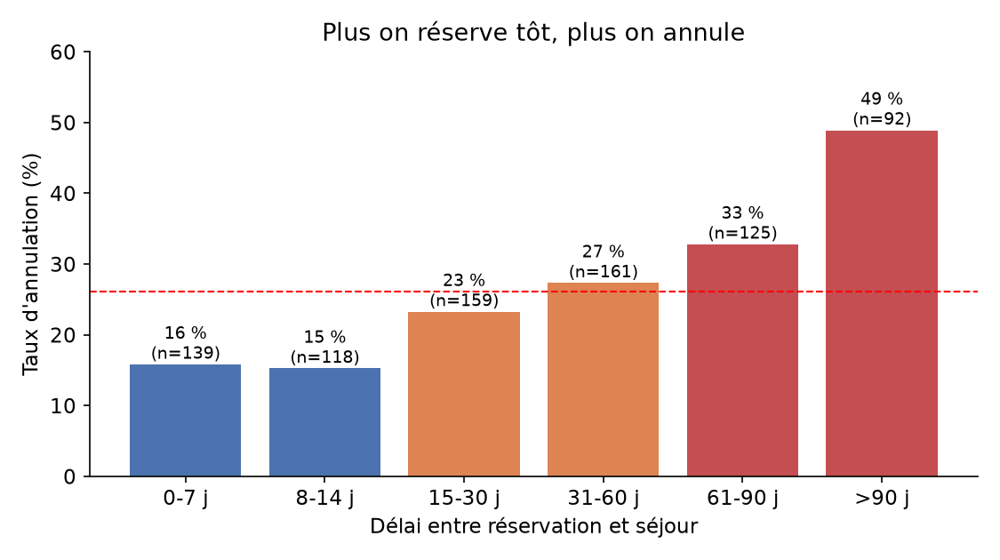

# Groupe-Valmont

### Tache:

# Tâche 1 : Nettoyage des données 

Cette tâche consiste à nettoyer et préparer les données de réservation et les informations hôtelières du projet Valmont afin de disposer d'un jeu de données fiable pour les prochaines étapes du projet.

Le traitement est réalisé en Python avec la bibliothèque Pandas.

## 1. Explication du code de nettoyage (`GroupeValmont.py`)

Le script réalise un pipeline complet de préparation des données en plusieurs étapes clés :

* **Fusion des tables :** Les fichiers `Valmont_reservations.csv` (940 lignes) et `Valmont_hotels.csv` (32 lignes) sont fusionnés via la clé commune `hotel_id`.
* **Suppression des doublons :** 140 lignes dupliquées (basées sur `reservation_id`) sont supprimées, ramenant le jeu de données à 800 lignes.
* **Imputation des valeurs manquantes :** 
  * Pour la colonne numérique `nb_personnes` (20 valeurs manquantes), les trous sont comblés par la **médiane**.
  * Pour la colonne qualitative `petit_dejeuner` (20 valeurs manquantes), les trous sont comblés par le **mode** (valeur la plus fréquente).
* **Traitement des anomalies (Q9) et filtrage final :** Les réservations aberrantes sont identifiées, comptabilisées, puis écartées (**6 dossiers supprimés**).
* **Exportation :** Le fichier final propre et validé est enregistré sous le nom de **`Valmont_cleaned.csv`** (contenant exactement **794 lignes**).

## 2. Réponse à la Question 9

### A. Faut-il les bloquer avant confirmation ?
**Oui, de manière impérative.** Il faut mettre en place des filtres automatiques sur le système de réservation en amont pour empêcher la validation de tarifs nuls/négatifs , de séjours supérieurs à 30 nuits ou d'un nombre de personnes incohérent, évitant ainsi les erreurs de planning et les pertes financières.

### B. Nombre de dossiers anormaux par mois
Le script a identifié un total de **6 dossiers anormaux**, dont la répartition mensuelle affichée dans le terminal est la suivante :
* **Mois 1 :** 1 dossier
* **Mois 2 :** 1 dossier
* **Mois 3 :** 2 dossiers
* **Mois 5 :** 1 dossier
* **Mois 6 :** 1 dossier

*(Aucune anomalie sur les autres mois).* Cela montre qu'il s'agit d'erreurs humaines de saisie ponctuelles et non d'un problème saisonnier.

# Tâche 2 : analyse des annulations et des délais (Q1 et Q2)

On part du fichier nettoyé de la tâche 1 (`Valmont_cleaned.csv`, 794 réservations). Au total, 26 % des réservations sont annulées. Le code est dans `analyse_annulations/tache2_annulations.py` (`pip install -r analyse_annulations/requirements.txt`, puis `python analyse_annulations/tache2_annulations.py`). Le script affiche les résultats dans le terminal et génère les deux graphiques.

## Q1) Qu'est-ce qui distingue une réservation annulée d'une réservation honorée ?

Le revenue manager accuse les plateformes, les directeurs accusent le loisir. On a comparé les annulations selon chaque variable disponible.

**Canal.** Il n'y a quasiment pas de différence : 28 % d'annulations sur les OTA contre 27 % en direct, et le test du khi-deux ne montre aucun lien (p = 0,60). Les plateformes ne sont pas en cause.

**Segment.** À première vue les directeurs ont raison : le loisir annule 32 % du temps contre 16 % pour les affaires. Mais les clients loisir réservent beaucoup plus tôt (56 jours en médiane, contre 9 pour les affaires). Une régression logistique qui tient compte du délai montre que le segment ne compte plus (p = 0,32 pour les affaires et 0,60 pour les groupes).

**Ce qui distingue vraiment une annulation, c'est le délai de réservation** : 52 jours en médiane pour les annulées, contre 22 pour les honorées. Le week-end, le petit-déjeuner, la catégorie de l'hôtel, le mois du séjour et le prix n'ont aucun lien avec l'annulation. Le nombre de personnes est légèrement plus élevé sur les annulées (2 en médiane contre 1), mais cette variable n'est pas retenue dans le modèle final.

  
   <em>Taux d'annulation par canal de vente et par segment (ligne rouge : taux moyen de 26 %)</em>

## Q2) Un client qui réserve tôt est-il un client sûr ?

Non, c'est l'inverse : plus on réserve tôt, plus on annule.

| Délai de réservation | Taux d'annulation | Réservations |
|---|---|---|
| 0 à 7 jours | 15,8 % | 139 |
| 8 à 14 jours | 15,3 % | 118 |
| 15 à 30 jours | 23,3 % | 159 |
| 31 à 60 jours | 27,3 % | 161 |
| 61 à 90 jours | 32,8 % | 125 |
| plus de 90 jours | 48,9 % | 92 |

Au-delà de 90 jours, une réservation sur deux est annulée. Dans la régression, chaque tranche de 10 jours de délai en plus augmente les chances d'annulation d'environ 13 % (odds ratio 1,13). Les clients les plus fiables sont ceux qui réservent peu de temps avant leur séjour.

  
   <em>Plus on réserve tôt, plus on annule</em>

## Pourquoi ces méthodes

| Méthode | Pourquoi on l'a choisie |
|---|---|
| Taux d'annulation par catégorie | Simple à lire, un directeur peut le comprendre directement |
| Test du khi-deux | Teste le lien entre deux variables qualitatives (canal, segment... et annulation) |
| Test de Mann-Whitney | Compare une variable chiffrée entre annulées et honorées. Délai et prix sont très asymétriques, donc on évite le test t qui suppose une distribution normale |
| Régression logistique | Mesure l'effet de chaque variable en tenant compte des autres. Elle montre que le segment n'agit qu'à travers le délai |
| Corrélation de Spearman (0,23) | Mesure le lien entre délai et annulation sans supposer qu'il est linéaire |

## Limites

Le délai est la seule variable qui explique les annulations, mais il ne suffit pas pour les prédire correctement (AUC de 0,66). On essaiera de l'améliorer dans la tâche 5. Il faut aussi être prudent sur les affaires qui réservent à plus de 30 jours : il n'y en a que 10 dans les données.

Tâche 3 : Segmentation des clients pour remplacer l'ancien système (Q7 et une partie de la Q8)

Tâche 4 : Modèle de prix et test de robustesse en haute saison (Q3 et Q4)

Tâche 5 : Prédiction des annulations et calcul de l'overbooking (Q5 et Q6)

Réponse à la Question 5 et à la Question 6 (Score de risque et surréservation)
Méthode retenue et justification : K plus proches voisins (KNeighborsClassifier) encapsulé
dans un make_pipeline(StandardScaler(), ...) avec optimisation de k par validation
croisée stratifiée (StratifiedKFold). Le pipeline empêche toute fuite de données lors de la
standardisation, et predict_proba() estime le risque individuel dès la réservation.

Règle d'overbooking (Q6) : Un client refusé à l'arrivée coûte nettement plus cher qu'une chambre
vide. Bien que le taux moyen d'annulation soit de 26,1 %, nous appliquons une règle prudente basée
sur le plancher d'annulation (15 %) divisé par deux, soit un plafond maximal de 8 % de
surréservation par établissement (activé uniquement lorsque le carnet contient des réservations
prises à plus de 30 jours). Pour un hôtel de 188 chambres, cela autorise au maximum 15 chambres
surréservées

Tâche 6 : Politique tarifaire, services inclus et chiffrage des gains sur les chambres vides (fin de la Q8)
