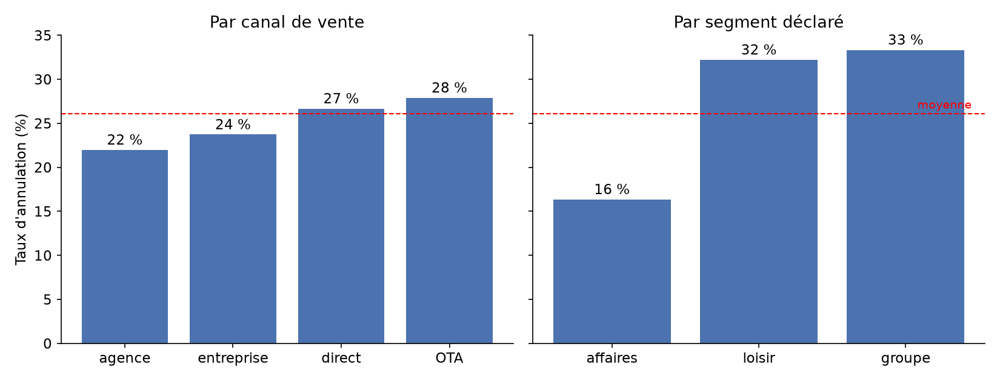
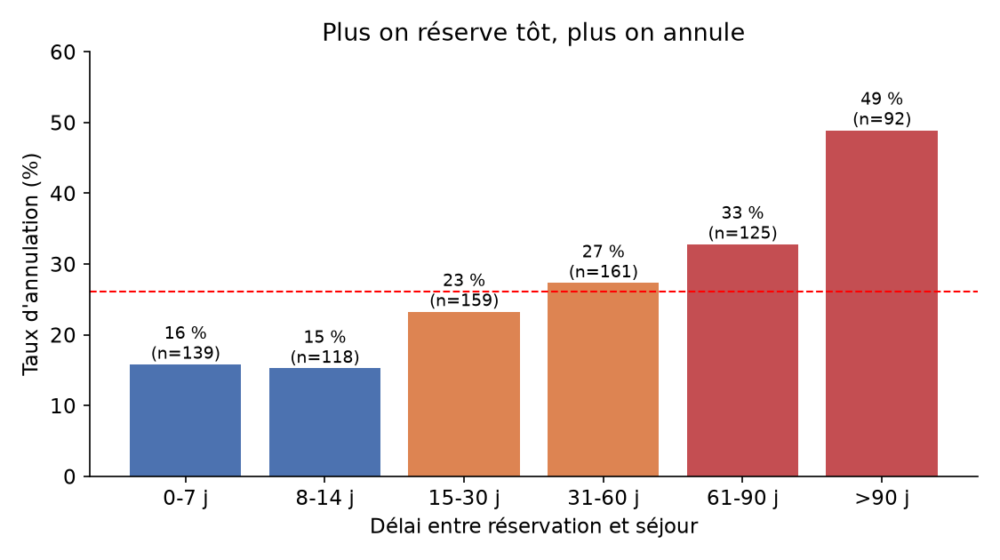

# Tâche 2 : analyse des annulations et des délais (Q1 et Q2)

Pour cette partie, on est partis du fichier nettoyé de la tâche 1 (`Valmont_cleaned.csv`, 794 réservations). Au total, 26 % des réservations sont annulées. Le code se trouve dans `tache2_annulations.py`.

## Q1) Qu'est-ce qui distingue une réservation annulée d'une réservation honorée ?

Au départ, le revenue manager accuse les plateformes et les directeurs accusent le loisir. On a donc comparé les annulations selon chaque variable disponible.

Pour le canal, il n'y a quasiment pas de différence, on a 28 % d'annulations sur les OTA contre 27 % en direct, et le test du khi-deux ne montre aucun lien (p = 0,60). Les plateformes ne sont donc pas en cause.

Pour le segment, les directeurs ont l'air d'avoir raison à première vue, puisque le loisir annule 32 % du temps contre 16 % pour les affaires. Mais les clients loisir réservent beaucoup plus tôt (56 jours en médiane, contre 9 pour les affaires). On a donc fait une régression logistique pour voir ce qui se passe quand on tient compte du délai. Dans ce cas, le segment ne compte plus (p = 0,26 pour les affaires et 0,89 pour les groupes).

Ce qui distingue vraiment une réservation annulée, c'est le délai de réservation, on a 52 jours en médiane pour les annulées, contre 22 pour les honorées. Le week-end, le petit-déjeuner, la catégorie de l'hôtel, le mois du séjour et le prix n'ont aucun lien avec l'annulation.

## Q2) Un client qui réserve tôt est-il un client sûr ?

Non, les données montrent l'inverse. Plus on réserve tôt, plus on annule.

| Délai de réservation | Taux d'annulation | Réservations |
|---|---|---|
| 0 à 7 jours | 15,8 % | 139 |
| 8 à 14 jours | 15,3 % | 118 |
| 15 à 30 jours | 23,3 % | 159 |
| 31 à 60 jours | 27,3 % | 161 |
| 61 à 90 jours | 32,8 % | 125 |
| plus de 90 jours | 48,9 % | 92 |

Au-delà de 90 jours, une réservation sur deux est annulée. Dans la régression, chaque tranche de 10 jours de délai en plus augmente les chances d'annulation d'environ 12 %. Les clients les plus fiables sont donc ceux qui réservent peu de temps avant leur séjour.

## Pourquoi ces méthodes

| Méthode | Pourquoi on l'a choisie |
|---|---|
| Taux d'annulation par catégorie | Simple à lire, un directeur peut comprendre directement |
| Test du khi-deux | Pour tester le lien entre deux variables qualitatives (canal ou segment et annulation) |
| Test de Mann-Whitney | Pour comparer une variable chiffrée entre annulées et honorées. Le délai et le prix sont très asymétriques, donc on évite le test t qui suppose une distribution normale |
| Régression logistique | Pour voir l'effet de chaque variable en tenant compte des autres. C'est elle qui montre que le segment n'agit qu'à travers le délai |
| Corrélation de Spearman (0,23) | Pour mesurer le lien entre délai et annulation sans supposer qu'il est linéaire |
| Arbre de décision | Pour trouver des seuils de délai utilisables en pratique. Il en ressort un seuil net autour de 120 jours |

## Limites

Le délai est la seule variable qui explique les annulations, mais il ne suffit pas pour les prédire correctement (AUC de 0,66). C'est ce qu'on essaiera d'améliorer dans la tâche 5. Il faut aussi être prudent sur les affaires qui réservent à plus de 30 jours, il n'y en a que 10 dans les données.